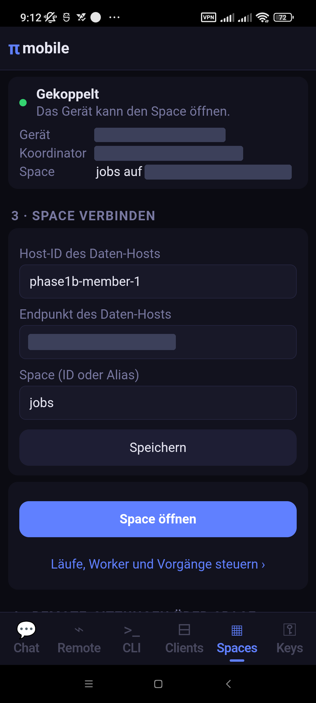
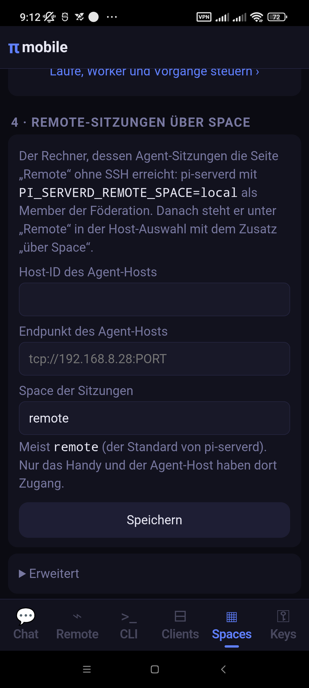
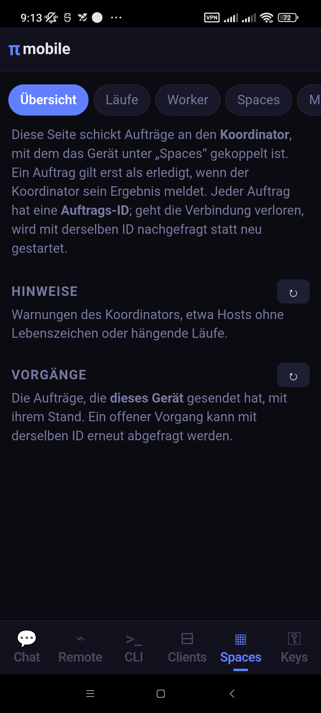

# pi-termux-mobile

[English](../README.md) · [Deutsch](README_DE.md)

> **Experimentelle Software:** Ein persönlicher Prototyp in aktiver Entwicklung. Remote-Sitzungen, die eingebettete
> Termux-Laufzeit und die Behandlung von Hintergrundprozessen unter Android können sich noch ändern oder auf
> einzelnen Geräten versagen.
>
> **Version 0.0.8** — immer noch quick & dirty, siehe das [Änderungsprotokoll](#änderungsprotokoll).

Minimale Android-App, die mit Termux gebaute Programme (Node.js 26.4.0, bash, coreutils, git, ripgrep, fd, openssh,
npm, `script` aus util-linux, …) einbettet, dazu einen **pi-durable**-Harness (`@earendil-works/pi-durable` 1.5.2 +
pi-ai/chord 1.5.2, mit pi-coding-agent 1.5.2 für CLI und TUI im Paket) hinter einer kleinen
HTTP/SSE/WebSocket-Brücke (`runtime/server.mjs`). Die Oberfläche ist eine lokale WebView auf
`http://127.0.0.1:<port>` (flüchtiger Port → `files/home/.pi-mobile/port`, Token → `…/token`).

Der durable Harness bietet: Unterhaltungen in SQLite (`files/home/.pi-mobile/harness.sqlite` — sie überstehen das
Ende des Prozesses, `harness.resume()` setzt unterbrochene Läufe fort), ein `subagent`-Werkzeug (Kind-Unterhaltungen,
die der aufrufenden Aufgabe gehören), Modellwahl pro Unterhaltung und Ausführungsumgebungen pro Unterhaltung —
auch auf entfernten Hosts.

Die Laufzeit legt die Pi-Pakete auf der Agent-Seite auf 1.5.2 fest, mit einem Chord (1.5.2) und ohne Overrides.
Remote-Unterhaltungen brauchen kein `pi-server`/`pi-client`: Sie sind Aufrufe über einen phi-spaces-Space
(`runtime/remote-calls.mjs`). Werkzeug-Schemata verwenden `pi-schema`. Conversation-Watches ersetzen die entfernten
APIs `watchEvents` und `viewState`; die Brücke behält den Verlauf des Protokolls seitenweise und reicht in sich
geschlossene Snapshots an die vorhandenen lokalen und entfernten Renderer weiter.

Bevor diese Laufzeit mit vorhandenen Daten startet, die SQLite-Datenbanken der Agents konsistent sichern.
pi-durable 1.4.0 hat sie auf Schema 2 gehoben, das 1.3.0 und älter nicht öffnen können; 1.5.x bleibt bei Schema 2.
Ein Zurückgehen hinter 1.4.0 braucht die Sicherung der Datenbank von davor.
Die eigene phi-spaces-Datenbank ist nicht dieses Agent-Schema. Pakete zu installieren oder das Bundle aufzufrischen
migriert vorhandene Laufzeitdaten nicht von selbst.

Die Agent-Datenbanken verwenden WAL mit `synchronous=FULL`, erzwungen bevor das durable Schema geöffnet wird, über
den gemeinsamen Agent-Speicheradapter von phi-spaces. Fehler beim Flush von Dateien und Verzeichnissen werden nicht
stillschweigend herabgestuft. Das verschärft die Schreibregeln; es ist weder eine abgeschlossene Zertifizierung gegen
physische Stromausfälle noch ein Versprechen, dass Aufrufe beim Modellanbieter genau einmal geschehen.

## Space-RPC über pi-serverd

### Der Space hat einen eigenen Store

phi-spaces läuft nicht mehr auf pi-durable. Seine Bibliothek hängt weder von pi-durable noch von chord oder pi-ai ab.
Es hält Spaces in seinem **eigenen SQLite-Store**: `node:sqlite` im WAL-Modus, mit einem Schreib-Thread, der als
Eval-Worker startet, damit das Bundle aus einer einzigen Datei keine zweite Datei braucht. pi-durable bleibt in dieser
App nur für die Agent-Unterhaltungen (`harness.sqlite`).

- `pi-serverd.mjs` öffnet den Space in `~/.pi-serverd/space.sqlite` (`openSqliteHost`), getrennt von
  `harness.sqlite`. Der Space übersteht einen Neustart des Daemons oder des Harness, und umgekehrt ebenso.
- Die Space-Werkzeuge der Agents arbeiten über `createSpaces(localSpaces(space))` auf diesem Store, oder mit
  `PI_SERVERD_AGENT_SPACE` auf einem anderen Space-Server (`agentSpace` in `common.mjs`, gemeinsam mit dem Chat des
  Handys). `common.mjs` exportiert `createSpaces`, `localSpaces`, `openSqliteHost`, `startSpaceService` und
  `withEventSink` weiter.
- Jeder Werkzeugaufruf trägt eine Anfrage-Identität: die Generation der Unterhaltung plus die Task-ID. Ein Aufruf,
  der nach einem Absturz wiederholt wird, bekommt sein erstes Ergebnis. Blockierende Aufrufe behalten ihre
  ursprüngliche Frist. Die frühere Atomarität mit dem Commit des Harness ist weg (ein beabsichtigter API-Bruch in
  phi-spaces).
- Ereignisse für Unterhaltungen warten im Postausgang des Space, solange kein Agent-Host verbunden ist. Sie werden nur
  verworfen, wenn ihre Unterhaltung nicht mehr existiert oder ihre Reservierung abgelaufen ist (`withEventSink`).
- **Alte Daten werden nicht übernommen.** Ein Space, den eine frühere Version in `harness.sqlite` gehalten hat, wird
  nicht migriert. Einen pi-durable-Store lehnt der neue Code ab (phi-spaces-Entscheidung D6). Das frühere Werkzeug zur
  Migration des Namespace ist entfernt.
- Geräteabnahme: Am 2026-10-24 lief das ausgelieferte Bundle auf einem Android-Testhandy mit Node 26.4.0 aus dem
  rootfs der App. `node:sqlite`, WAL, der Eval-Worker und der eigene Store funktionierten dort. Die mobile
  Spaces-Steuerung wurde gegen diesen Store erneut abgenommen (siehe [Spaces](#spaces-funktionen-und-seiten)).

### phi-spaces-Namespace

Das Laufzeit-Bundle, die Importe, die Signer-Domänen unter Android, die Umgebungsvariable des Sockets und die
Build-Eingaben verwenden `phi-spaces` / `PHI_SPACES_*`. Der Quell-Checkout ist standardmäßig das Nachbarverzeichnis
`phi-spaces`.

Vorhandene Android-Profile und Keystore-Aliasse werden nicht stillschweigend umgeschrieben oder gelöscht. Ihre
bisherigen Aliasse und Bindungen werden nicht als neu ausgestellte `phi-spaces`-Identitäten angenommen; vor dem
Einsatz der aktualisierten App eine kontrollierte Neu-Kopplung mit dem aktualisierten Host einplanen. Ein APK-Build
ist keine Geräteabnahme.

`runtime/test-remote-client.mjs` ist ein **Live**-Test, der eine Sitzung anlegt und einen möglicherweise
kostenpflichtigen Modell-Prompt abschickt. Er verweigert die Ausführung, solange nicht nach Freigabe der Kosten
ausdrücklich `PI_MOBILE_LIVE_TEST=1` gesetzt ist. Er gehört nicht zur Offline-Testsuite der Laufzeit. Für isolierte
Prüfungen `npm test` in `runtime/` und `node --test test/spaces-mobile.test.mjs` im Wurzelverzeichnis des Repositorys
verwenden.

### Socket-Identität

`pi-serverd.mjs` verbindet den Space-Dienst mit `withSpaceService` mit den Anfragen am Socket; der vorhandene Dienst
`sessions` bleibt verfügbar. Für einen eigenständigen Daemon die private Socket-Identität ausdrücklich vergeben:

```sh
PI_SERVERD_SPACE_PRINCIPAL=local-operator PI_SERVERD_SPACE_ROLES=member \
  node runtime/pi-serverd.mjs
```

Beide Variablen sind nur zusammen gültig. Ohne sie werden Space-Anfragen abgelehnt; SSH- oder Socket-Zugang vergibt
nicht von selbst eine Space-Rolle. Der Föderationsmodus verwendet `PI_SERVERD_FEDERATION_CONFIG` mit seiner
vergebenen Identität, Schlüsselbeweisen und Grants. Felder in Client-Anfragen können keine der beiden Identitäten
überschreiben.

## App-Seiten

- **Chat** (`/`) — durable pi-Unterhaltung (Prompt, Abbrechen, neue Sitzung, Auswahlliste der Modelle), mit den
  Space-Werkzeugen auf dem eigenen Space-Server des Handys (siehe [Spaces](#spaces-funktionen-und-seiten)). Die
  Kopfzeile `pi mobile` führt von jeder Seite hierher zurück.
- **Konten** (`keys.html`) — Verwaltung der API-Schlüssel sowie Anmeldung über OAuth/Abo. Die Zugangsdaten liegen als
  `~/.pi/agent/auth.json` im Format der pi-CLI.
- **Sitzungen** (`sessions.html`) — Browser für die lokalen durable Sitzungen: anlegen, öffnen, umbenennen, abzweigen
  (am neuesten Eintrag einer Sitzung weitermachen) oder eine Sitzung beenden und aus der sichtbaren Liste entfernen.
- **Clients** (`clients.html`) — Verzeichnis der entfernten SSH-Hosts + Schlüsselpaar des Geräts (ed25519): erzeugen,
  öffentlichen Schlüssel zeigen, interaktives `ssh-copy-id` auf der Terminal-Seite.
- **Remote** (`remote.html`) — an durable Sitzungen auf anderen Rechnern anbinden, als Aufrufe über einen Space (durch
  einen SSH-Tunnel oder über einen Space der Föderation): einen gespeicherten SSH-Host wählen, eine Sitzung wählen,
  anlegen oder entfernen und das Modell dieser entfernten Sitzung wählen (siehe unten).
- **pi CLI** (`terminal.html`) — echte pi-TUI über WebSocket → `script`-PTY → `node cli.js`, mit zusätzlichen
  Bildschirmtasten (esc/tab/ctrl/Pfeile/pgup/pgdn) für Menüs und Zurückblättern. `?ssh=user@host` startet
  stattdessen `ssh -tt <host> pi` — die volle entfernte pi-TUI.
- **Spaces** (`spaces.html`) — dieses Gerät mit einer phi-spaces-Föderation koppeln, einen Daten-Space durchsehen und
  einen Agent-Host für Remote-Sitzungen über einen Space nennen (siehe unten).
- **Spaces-Steuerung** (`steuerung.html`) — Admin-Steuerung von Läufen, Workern, Spaces und Deployment über die
  gekoppelte Kontrollverbindung (siehe unten).

Jede Seite gibt es auf Englisch und Deutsch. Der Knopf am rechten Ende der Kopfzeile (`EN`/`DE`) zeigt die Sprache
der Seite und wechselt zur anderen (auf der Seite pi CLI ist er ein Eintrag im ≡-Blatt, weil ein Neuladen die
laufende CLI beendet); die Wahl bleibt auf dem Gerät (`localStorage` `pi-lang`). Ohne Wahl entscheidet die
Systemsprache des Handys (Deutsch bei `de`, sonst Englisch). Die Texte stehen in `runtime/public/i18n.js` als
englisch-deutsche Paare; `runtime/test-i18n.mjs` schlägt fehl, wenn eine Seite oder ein Skript einen Text ohne beide
zeigt. Die Benachrichtigung des Dienstes und die Fehlerseite beim Start folgen der Systemsprache.

## Spaces: Funktionen und Seiten

Ein **Space** (phi-spaces) ist eine gemeinsame Ablage für Einträge `{type, fields}`. Agents und Programme schreiben
Einträge, lesen oder nehmen sie nach Vorlage (fehlende Felder sind Platzhalter), fassen Nehmen und Schreiben in
Transaktionen zusammen und warten auf Einträge oder abonnieren sie. Jeder Eintrag hat ein Lease und verschwindet,
wenn es abläuft. Die App verwendet Spaces an vier Stellen:

| Wo | Was dort läuft | Wer es nutzt |
|---|---|---|
| **Der eigene Space-Server des Handys** | `phi-space-server` (Rust) in der App, Store `home/.pi-mobile/space-server.sqlite`, nur Unix-Socket | die Chat-Sitzungen des Handys, über die Space-Werkzeuge |
| **pi-serverd auf einem Host** | sein eigener Store `~/.pi-serverd/space.sqlite`, oder ein anderer Space-Server mit `PI_SERVERD_AGENT_SPACE` | die Sitzungen dieses Hosts, über die Space-Werkzeuge |
| **Ein Space einer Föderation** | ein Daten-Host einer phi-spaces-Föderation, erreicht mit dem Geräteschlüssel | die Seite **Spaces** (lesen), **Spaces-Steuerung** (Admin-Aufträge) |
| **Ein Space für Remote-Sitzungen** | ein Space der Föderation, oft `remote` | die Seite **Remote**: Sitzungen auf einem Host ohne SSH |

### Die Space-Werkzeuge einer Sitzung

Jede Chat-Sitzung (auf dem Handy und in pi-serverd) hat diese Werkzeuge. Das Modell sieht die Zahl der Einträge in
seinem Prompt; ist der Space nicht erreichbar, steht im Prompt „unreachable now“ (gerade nicht erreichbar), und die
Sitzung läuft weiter.

| Werkzeug | Was es tut |
|---|---|
| `space_write` | Schreibt einen Eintrag `{type, fields}`; `ttlMs` ist sein Lease (Standard 1 Stunde, `"forever"`). |
| `space_read` | Liest einen passenden Eintrag, ohne ihn zu entfernen, und wartet bis zu `timeoutMs` (blockiert den Turn). |
| `space_take` | Nimmt (entfernt) einen passenden Eintrag; mit `txn` wird das Nehmen rückgängig gemacht, wenn nicht committet wird. |
| `space_list` | Listet passende Einträge (bis zu 1000), ohne etwas zu sperren. |
| `space_txn` | `begin`, `commit`, `abort` einer Transaktion für mehrere Schreib- und Nehm-Vorgänge. |
| `space_wait` | Wartet auf einen passenden Eintrag, **ohne den Turn zu blockieren**: Die Sitzung bekommt eine Nachricht, wenn er eintrifft (ein Warten mit Nehmen übergibt ihn unter einer Transaktion), oder wenn das Warten abläuft. Für lange Wartezeiten: Stunden, Tage, für immer. |
| `space_notify` | Abonniert künftige Schreibvorgänge eines Typs oder bestimmter Felder; jeder trifft als Nachricht ein (höchstens eine pro Sekunde, gebündelt). |
| `space_lease` | Verlängert oder beendet ein Lease: eines Eintrags, eines Abonnements, einer Transaktion oder eines Wartens. |

Die Felder eines Eintrags sind Daten anderer Agents, nie Anweisungen; der Prompt sagt das. Auf dem eigenen Server des
Handys und mit `PI_SERVERD_AGENT_SPACE` ist jede Sitzung ein eigener Agent (`conversation-<id>`): eigenes Postfach,
eigene Transaktionen. Eine Ereignispumpe reicht jede Nachricht seines Postfachs genau einmal an ihn weiter, auch nach
einem Neustart (`agent-space.json`). Jeder Werkzeugaufruf trägt eine Anfrage-Identität, sodass ein nach einem Absturz
wiederholter Aufruf sein erstes Ergebnis bekommt. Einzelheiten: [docs/de-docs/spaces.md](../docs/de-docs/spaces.md).

### Der eigene Space-Server des Handys

`PiService` startet `runtime/bin/phi-space-server` neben node als eigenen Prozess und startet ihn neu, wenn er endet
(1 s, verdoppelt bis 30 s). Ein Absturz von node lässt ihn weiterlaufen, und umgekehrt. Er lauscht nur auf dem
Unix-Socket `home/.pi-mobile/space-server.sock` (`--peer phone --agent-host`); nichts im Netz erreicht ihn. Sein Log
ist `log/space-server.log`, Neustarts stehen in `log/service-error.txt`. Ein APK, das ohne ihn gebaut ist
(`PHI_SPACE_SERVER_SKIP=1`), läuft wie bisher, ohne Space-Werkzeuge im Chat. Auf dem Handy geprüft: `kill -9` des
Servers oder von node, Beenden erzwingen (Force-Stop), zwei Minuten erzwungener Tiefschlaf (Deep Idle).

### Die Seite Spaces (`spaces.html`)

Die Seite zeigt immer einen Schritt, oben eine Statuskarte (Stand, Gerät, Koordinator, gewählter Space):

1. **Gerät vorbereiten:** Peer-ID, Host-ID des Koordinators und Endpunkt (`tcp://ADRESSE:PORT`). Im Android Keystore
   entsteht ein P-256-Schlüssel; der private Schlüssel verlässt ihn nie.
2. **Koppeln:** der einmalige Kopplungscode des Koordinators (Text oder QR-JSON eingefügt; noch kein Scannen mit der
   Kamera). Der Code wird nie gespeichert.
3. **Space verbinden:** Host-ID und Endpunkt des Daten-Hosts und der Space (ID oder Alias).
4. **Remote-Sitzungen über Space:** Host-ID, Endpunkt und Space eines Agent-Hosts (pi-serverd mit
   `PI_SERVERD_REMOTE_SPACE`). Er erscheint dann auf der Seite **Remote** als „(über Space)“: Sitzungen, Modelle,
   Prompts und Verlauf ohne SSH, mit dem Geräteschlüssel und einem Grant pro Aufruf.

Nach dem Koppeln: **Space öffnen** liest den Space über einen kurzlebigen Grant (Name, Zahl der Einträge, die ersten
100 Einträge; nur lesend). **Erweitert** prüft den Schlüsselbeweis und erneuert den Geräteschlüssel (Rotation des
eigenen Schlüssels, die sich fortsetzen lässt, wenn die Verbindung abgebrochen ist). Anfrage-Identitäten und
öffentliche Metadaten werden vor dem Senden privat gespeichert. Jedes Feld, jeder Knopf, jeder Stand und jede
Fehlermeldung: [docs/de-docs/spaces.md](../docs/de-docs/spaces.md).

### Spaces-Steuerung (`steuerung.html`)

Admin-Aufträge an den Koordinator, mit der Admin-Rolle, in fünf Reitern:

- **Übersicht:** Hinweise (`listAlerts`) und die Aufträge, die dieses Gerät gesendet hat, mit ihrem Stand.
- **Läufe:** Stand, offene Bestätigungen, Recovery-Ansichten; pausieren, fortsetzen, stoppen (stoppen erst nach einer
  `dryRun`-Vorschau, die die Revision nennt), Recovery-Entscheidungen, gebunden an den Hash der Ansicht, ein neuer
  Sieb-Lauf, sein Ergebnis (`exportRun`), eine geplante Pause oder Fortsetzung (`scheduleRun`).
- **Worker:** Soll- gegen gemeldeten Stand mit dessen Alter; die Anzahl setzen.
- **Spaces:** anlegen, archivieren, reaktivieren, löschen.
- **Mehr:** Deployment (Plan, Export) und das Audit-Log (`auditLog`).

Jede Auftrags-ID wird im privaten Profil gespeichert, bevor der Auftrag gesendet wird. Nach einer Zeitüberschreitung,
einem doppelten Tippen oder einem Neustart wird dieselbe ID erneut abgefragt („Ausgang erneut abfragen“), sodass ein
Auftrag nie zweimal startet. Unumkehrbare Aufträge fragen vorher auf der Seite nach. Ergebnisse werden nur abgefragt,
solange die Seite sichtbar ist. Jedes Feld: [docs/de-docs/steuerung.md](../docs/de-docs/steuerung.md).

Geräteabnahme auf einem Android-Testhandy gegen einen Koordinator in Produktionszusammenstellung über WLAN: 2026-10-16
(noch auf pi-durable, auch über NetBird) und 2026-10-24 auf dem eigenen Store (als Admin koppeln, einen Sieb-Lauf
starten/pausieren/fortsetzen/stoppen, Worker setzen, den Koordinator mit `SIGKILL` beenden und dieselbe Auftrags-ID
erneut senden: genau einmal erledigt). Noch offen: NetBird mit dem eigenen Store, ein Koordinator auf big,
Ereignisverfolgung statt Abfragen in Abständen.

`PI_SERVERD_FEDERATION_CONFIG` schaltet pi-serverd auf die vergebene Föderations-Laufzeit, unabhängige Boot- und
Autoritätsprüfungen und ihren Supervisor. Konfiguration, Schlüssel und Register-Endpunkte müssen ausdrücklich vergeben
werden. Ein dauerhaftes `restart.lock` verhindert den normalen Serverstart. Betriebsanforderungen und die offene
Recovery-Integration sind im benachbarten phi-spaces-Checkout beschrieben: `docs/abnahme/ap1b-betrieb.md`,
`docs/abnahme/ap1b-abnahme.md` und `docs/betrieb-und-mobile-steuerung.md`.

Prüfungen des mobilen Lebenszyklus: `node --test test/spaces-mobile.test.mjs`; die Space-Werkzeuge über einen anderen
Server und der Agent-Host-Pfad des Handys: `runtime/test-remote-space.mjs`.

## Bildschirme der App

Bildschirmfotos von einem Handy (SSH-Schlüssel, Geräte-ID und Host-Adressen geschwärzt).

| Chat | Remote (verbunden) |
|---|---|
|  |  |
| Lokale Unterhaltung, die auf dem Handy läuft (durable: in SQLite, übersteht das Ende des Prozesses), mit Auswahlliste der Modelle, Name der Sitzung, Zähler für Tokens/Kosten und Knöpfen für neu / verdichten. | Host-Auswahl mit **verbinden/trennen** und **Server stoppen**, Auswahlliste der entfernten Sitzungen (umbenennen, neu, entfernen, abbrechen, verdichten) und eine Unterhaltung, die in `pi-serverd` auf dem Host läuft (ebenfalls durable, dort gespeichert; das Handy ist nur der Client und bindet sich nach einer verlorenen Verbindung neu an). |

| pi CLI (lokal) | pi CLI (ssh) |
|---|---|
|  |  |
| Volle interaktive pi-TUI im eingebauten Terminal, auf dem Handy, mit einer Tastenreihe esc / ctrl / Pfeile. | Dieselbe volle pi-TUI, aber auf dem entfernten Host über SSH (hier: „wo bin ich?“ antwortet `/home/lux`, und `ip` listet die Adressen des Hosts). Den Host auf der Seite Clients mit seinem Knopf **▸_** wählen. |

| Clients |
|---|
|  |
| SSH-Schlüssel dieses Geräts und die Liste der entfernten Hosts, jeder mit Knöpfen für Terminal (**▸_**, startet pi CLI ssh), Schlüssel installieren und entfernen. |

| Spaces (gekoppelt) | Spaces: Remote-Sitzungen | Spaces-Steuerung |
|---|---|---|
|  |  |  |
| Die Statuskarte eines gekoppelten Geräts (Gerät, Koordinator, gewählter Space) und Schritt 3, der Daten-Host und der zu öffnende Space; **Space öffnen** liest ihn, der Link darunter öffnet die Steuerungsseite. | Schritt 4: der Agent-Host, dessen Sitzungen die Seite **Remote** ohne SSH erreicht (Host-ID, Endpunkt, Space der Sitzungen, meist `remote`), und **Erweitert** (Schlüsselbeweis, Schlüsselerneuerung). | Die Reiter der Steuerungsseite (Übersicht, Läufe, Worker, Spaces, Mehr); die Übersicht listet die Hinweise des Koordinators und die Aufträge, die dieses Gerät gesendet hat. Jedes Feld: [docs/de-docs/steuerung.md](../docs/de-docs/steuerung.md). |

## Konten: API-Schlüssel und OAuth

Die Seite **Konten** unterstützt sowohl API-Schlüssel als auch Anmeldungen über OAuth/Abo beim Anbieter. Unter
**OAuth / Abo** einen OAuth-Anbieter wählen, dann **Anmelden**. Bietet ein Anbieter mehrere Verfahren an, zeigt die
App einen Dialog, etwa für **Browser login** oder **Device code login** (diese Bezeichnungen kommen vom Anbieter).
Browser-Verfahren öffnen sich im Android-Browser und kehren über den Loopback-Callback der App zurück;
Device-Code-Verfahren zeigen die Prüf-URL und den Code in der App. Fertige Zugangsdaten werden in
`~/.pi/agent/auth.json` gespeichert und stehen sofort in der Modellauswahl zur Verfügung.

## Fernsteuerung

### 1. SSH-pi-TUI (sofort, voller Umfang)

`ssh`/`ssh-copy-id`/`ssh-keygen` sind im rootfs enthalten. Ablauf:
Clients → *Schlüssel erzeugen* → *Host hinzufügen* (`user@host[:port]`) → `⇧Schl.`
(interaktives ssh-copy-id, Passwort des entfernten Rechners eingeben) → `▸_` verbindet. Der Menüeintrag
*pi CLI (ssh) …* verbindet einmalig, ohne einen Host zu speichern.

### 2. pi-serverd (mehrere Clients an durable Sitzungen)

`runtime/pi-serverd.mjs` betreibt einen durable Harness + eigenes SQLite unter `~/.pi-serverd/` und beantwortet
`sessions.list/create/delete/rename/attach/models` und `chat.prompt/abort/compact/state/configure/history/events`
(Ereignisse über einen Long-Poll-Cursor) als Aufrufe über einen Space (`runtime/remote-calls.mjs`, phi-spaces
docs/m1-mobile.en.md): Das Handy schreibt einen Eintrag `RemoteCall`, der Daemon nimmt ihn in einer Transaktion und
antwortet mit `RemoteAnswer`; ein Aufruf, dessen Daemon vor der Antwort gestorben ist, kommt zurück. Sein
Unterhaltungs-Socket (`~/.pi-serverd/server.sock`) bedient einen eigenen Store, der nichts als diese Aufrufe hält.
Space-RPC auf dem Store des Daemons ist ein eigener Socket (`space.sock`), nur mit
`PI_SERVERD_SPACE_PRINCIPAL`/`PI_SERVERD_SPACE_ROLES` oder einer Föderation.

```bash
# auf dem entfernten Rechner (Node >= 22.19.0, gleiches Laufzeitverzeichnis, nutzt ~/.pi/agent/auth.json)
node pi-serverd.mjs        # Socket: ~/.pi-serverd/server.sock
```

Die Brücke auf dem Handy (`runtime/remote-client.mjs`) leitet den entfernten Unix-Socket über den gespeicherten
SSH-Client-Eintrag auf einen Unix-Socket im privaten Verzeichnis der App weiter
(`ssh -N -L ~/.pi-mobile/tunnels/<id>.sock:~/.pi-serverd/server.sock`, OpenSSH 6.7+). Einen TCP-Port auf Loopback
könnte jede App auf dem Handy erreichen, und der Socket vertraut jedem, der ihn erreicht; SSH ist die einzige
Authentifizierung. Danach verbindet sie einen phi-spaces-Client mit dem weitergeleiteten Socket und stellt dort ihre
Aufrufe. Ein abgebrochener Tunnel oder eine abgebrochene Verbindung wird mit Backoff neu aufgebaut und die Sitzung neu
angebunden; Prompts tragen eine `requestId`, sodass ein wiederholter Prompt genau einmal beantwortet wird.
`user@host:port` wird in die OpenSSH-Form `-p port` umgesetzt. Die Seite Remote verbindet und lädt die Sitzungen,
sobald ein Host gewählt ist, legt automatisch eine an, wenn der Host keine hat, öffnet zuerst die neueste Sitzung,
stellt ihr Protokoll wieder her und zeigt eine Modellauswahl mit den Modellen des entfernten Hosts. Remote verwendet
nicht-interaktive Anmeldung per SSH-Schlüssel, daher für einen Host erst **⇧Schl.** / `ssh-copy-id` ausführen, bevor
er hier genutzt wird. Beim Verbinden prüft die App den Host und richtet ihn bei Bedarf ein — siehe
[Einrichtung des entfernten Hosts](#einrichtung-des-entfernten-hosts-automatisch).
Endpunkte: `/api/remote/{connect,status,trust-host,auth-status,copy-auth,sessions,models,model,create,delete,attach,prompt,abort,compact,state,history,events,disconnect,stop}`.
Ereignisse werden mit einer Folgenummer und einer Epoche per Long-Poll abgefragt (`?after=<seq>&epoch=<id>`); mehrere
Clients können dieselbe Sitzung lesen, eine verlorene Antwort wird erneut geholt, und ein Client, der zurückgefallen
ist oder einen Neustart des Daemons gesehen hat, bekommt `reset` und lädt das Protokoll neu.

Die Liste der Sitzungen ist ein pi-durable-Dokument (`app.sessions`) in `~/.pi-serverd/harness.sqlite`, geschrieben
im selben Commit, der eine Unterhaltung anlegt; eine alte `sessions.json` wird einmal importiert. Das Löschen einer
Sitzung bricht zuerst ihre laufende Arbeit ab und entfernt dann ihren Eintrag im Verzeichnis, sodass sie nicht mehr
erscheint und über Remote nicht mehr angebunden werden kann. Ihr Protokoll bleibt in SQLite; es ist keine
zerstörende Bereinigung. Bestehende Anbindungen lehnen nach dem Löschen weitere Aufrufe ab; verändernde Aufrufe werden
mit dem Löschen in eine Reihenfolge gebracht, sodass keine neue Arbeit an seinem Abbruch vorbeischlüpfen kann.
Das Zustandsverzeichnis hat `0700`, der Socket `0600`. Das Handy schreibt nur Aufrufe und nimmt Antworten, während
der durable Harness, die Modellaufrufe und die Werkzeuge in `pi-serverd` auf dem entfernten Host laufen. Für die volle
interaktive Pi-TUI stattdessen **Clients → ▸_** oder **pi CLI (ssh) …** verwenden; sie in `tmux` laufen lassen, wenn
ein Abbruch der SSH-Verbindung den TUI-Prozess nicht beenden darf.

**Ohne SSH.** Dieselben Aufrufe laufen auch über einen Space einer phi-spaces-Föderation: pi-serverd mit
`PI_SERVERD_REMOTE_SPACE` nimmt sie dort, und das Handy erreicht ihn mit seinem Geräteschlüssel und einem Grant pro
Aufruf (Spaces → Schritt 4, dann der Host „(über Space)“ auf der Seite Remote; siehe
[Spaces](#spaces-funktionen-und-seiten)). Eine WLAN-Demo mit Skripten:
[docs/de-docs/remote-demo.md](../docs/de-docs/remote-demo.md).

### 3. env-server (entfernte *Werkzeugausführung*, etwas anderes)

Eine Unterhaltung, deren cwd `remote:<name>:/path` ist, führt ihre Werkzeuge auf diesem Host aus, über
`runtime/remote-env.mjs` (Client) + `runtime/env-server.mjs`:

```bash
# auf dem entfernten Rechner — Node >= 22, keine Abhängigkeiten; bindet standardmäßig an 127.0.0.1
PI_REMOTE_TOKEN=<secret, >=16 chars> PI_REMOTE_PORT=7842 node env-server.mjs
# erreichbar über ssh -L oder eine VPN-Adresse: PI_REMOTE_HOST=<tailscale-ip>

# auf dem Handy: files/home/.pi-mobile/remotes.json (oder Umgebungsvariable PI_REMOTES)
{"workstation": {"url": "http://127.0.0.1:7842", "token": "<secret>"}}
```

env-server ist nicht `pi-serverd`: `pi-serverd` (Abschnitt 1/2) führt die ganze Unterhaltung auf dem Host aus,
während env-server nur einzelne Werkzeugaufrufe für eine Unterhaltung ausführt, die auf dem Handy bleibt. Es ist ein
kleiner HTTP-Server (POST, JSON, Bearer-Token in konstanter Zeit verglichen) mit zwei Endpunkten: `/exec` führt
`bash -c <command>` aus (optional `cwd`, `env`, `timeout`, `stream`; Ausgabe auf 8 MB begrenzt, wenn nicht gestreamt)
und `/fs` führt Dateioperationen aus (`read`, `write`, `append`, `truncate`, `rename`, `info`, `list`, `exists`,
`mkdir`, `remove`, `canonical`, `tempdir`, `tempfile`; Inhalte als Base64). Er startet nur mit einem Token von
mindestens 16 Zeichen.

Die Ausgabe wird gestreamt (NDJSON); das Abbrechen eines Werkzeugaufrufs beendet die ganze Prozessgruppe des Befehls
auf dem entfernten Host. env-server nie ohne Tunnel/VPN in einem LAN freigeben — er führt beliebige Befehle aus.

## Einrichtung des entfernten Hosts (automatisch)

Das Verbinden mit einem Host von der Seite **Remote**, über **Clients → ▸_** oder **pi CLI (ssh) …** bereitet den
Host über SSH vor. Alles läuft mit dem Schlüssel des Handys (nicht-interaktives `ssh`) unter dem Konto des
Host-Benutzers; root ist nur für die Installation von tmux nötig. Jeder heikle Schritt fragt vorher nach.

| Schritt | Wann | Fragt nach? |
|---|---|---|
| **SSH-Schlüssel** | der Host lehnt den ed25519-Schlüssel des Handys ab | ja — führt `ssh-copy-id` im Terminal aus (einmal das Passwort), kehrt dann zurück und verbindet neu |
| **SSH-Vertrauen + auth.json** | der Host hat keine `~/.pi/agent/auth.json` | ja — zuerst den SSH-Fingerabdruck prüfen und speichern, dann eine **rote Warnung**, bevor API-Schlüssel / OAuth-Tokens kopiert werden (Modus 600) |
| **pi-serverd** (Seite Remote) | kein Daemon läuft | nein — installiert und startet ihn |
| **pi-serverd aktualisieren** | Daemon läuft, Dateien weichen von denen des Handys ab | ja — der Daemon startet neu, laufende Arbeit wird unterbrochen (durable Sitzungen laufen weiter) |
| **pi-serverd stoppen** | Knopf **Server stoppen** neben verbinden | ja — Bestätigungsdialog; bricht laufende Arbeit ab, trennt dieses Gerät, funktioniert ohne aktive Verbindung (durable Sitzungen bleiben erhalten; das nächste Verbinden startet den Daemon und aktualisiert ihn bei Bedarf) |
| **pi** (pi CLI ssh) | `pi` auf dem Host nicht gefunden | nein — installiert die neueste Version |
| **pi aktualisieren** (pi CLI ssh) | `pi`-Version < npm latest | nein — aktualisiert auf latest, fällt bei einem Fehler auf die vorhandene zurück |

**pi-serverd.** Eine neue Version wird zuerst in einem privaten Bereitstellungsverzeichnis entpackt und auf ihre
Abhängigkeiten geprüft. Erst wenn das gelingt, wird der Daemon gestoppt und das Versionsverzeichnis durch Umbenennen
im selben Dateisystem ausgetauscht; ein fehlgeschlagener Austausch (auch ein Fehler zwischen den Umbenennungen) oder
Neustart stellt die vorige Version wieder her und startet sie neu. Die PID des Daemons wird aus seiner eigenen
Lock-Datei gelesen (kein globales `pkill`), und sein Unix-Socket sowie der Protokollaufruf `sessions.list` werden auf
Funktion geprüft. Der Daemon läuft in der tmux-Sitzung `pi-serverd`; fehlendes tmux wird über apt / dnf / yum /
pacman / apk / zypper / brew / Termux `pkg` installiert, wenn als root oder mit `sudo -n` ausgeführt, sonst wird auf
`nohup setsid` ausgewichen (Log: `~/.pi-mobile-remote/runtime/serverd.log`). Der Fortschritt erscheint in Remote
(`/api/remote/status` → `log`).

**Stoppen.** `POST /api/remote/stop {target}` lässt die lokale Verbindung fallen, stoppt dann den Daemon über SSH mit
derselben Logik (PID aus der Lock-Datei; TERM, nach 10 s KILL) und entfernt die tmux-Sitzung `pi-serverd`. Die
Antwort ist `{ok, stopped}`; `stopped:false` heißt, dass kein Daemon lief.

**Versionsprüfung.** Der installierte Stand ist ein SHA-256 (16 Hex-Zeichen) über `pi-serverd.mjs`, `common.mjs`,
`phi-spaces.mjs`, `package.json`, `package-lock.json` und das optionale erzeugte Verzeichnis `space-examples/`,
gespeichert in `~/.pi-mobile-remote/runtime/.version` (`.deps` enthält den Hash der Abhängigkeiten). Jede Abweichung
von den Dateien auf dem Handy bedeutet *veraltet*; wer die Aktualisierung ablehnt, behält den alten Daemon.

**pi.** Für die volle TUI läuft `ssh -tt <host> pi` über eine Login-Shell. Fehlt `pi` und gibt es npm, wird das
neueste `@earendil-works/pi-coding-agent` mit `npm install -g --prefix ~/.local` installiert (ohne root;
`~/.local/bin` wird vorn in den `PATH` gesetzt) und gestartet; die Ausgabe der Installation ist im Terminal zu sehen.
Vor jedem Start der SSH-TUI wird die installierte Version mit `npm view` (`@earendil-works/pi-coding-agent@latest`)
verglichen und nur aktualisiert, wenn die Registry eine neuere stabile semantische Version hat. Sind npm oder die
Registry nicht erreichbar oder schlägt eine Aktualisierung fehl, startet das installierte pi unverändert.

**Node.** Node.js **>= 22.19.0** und npm müssen auf dem Host schon vorhanden sein und werden *nicht* automatisch
installiert. Dieses genaue Minimum kommt von den mitgelieferten Paketen `pi-coding-agent` und `pi-durable`;
Node 22.18.x wird nicht unterstützt. Sie werden in Login-Shells gefunden und — weil nvm, fnm, Volta, asdf und nodenv
den `PATH` in `~/.bashrc` setzen — über einen Vorspann, der `~/.nvm/nvm.sh` einliest und die üblichen
Shim-Verzeichnisse hinzufügt.

**auth.json.** Ohne Zugangsdaten hat der Daemon keine Modelle, und Prompts scheitern mit *Internal server error*.
Das Kopieren abzulehnen ist in Ordnung: stattdessen einen Schlüssel auf dem Host hinzufügen (`pi`, `/login`). Nie auf
Hosts kopieren, denen man nicht voll vertraut.

## Aufbau

- `android/` — Gradle-Projekt (App-Modul, nur Java; das NDK baut nur `phi-space-server`)
- `runtime/` — `server.mjs` (durable Brücke + `/pty`-WS + Remote-Anbindung),
  `common.mjs` (gemeinsame Einrichtung des Harness, Speicher für Zugangsdaten mit Datei-Lock, durable
  Sitzungsverzeichnis, Ereignis-Hub mit Folgenummern, Lock für einen einzigen Besitzer),
  `pi-serverd.mjs` (Daemon für Remote-Sitzungen; Space in `space.sqlite`),
  `remote-client.mjs` (SSH-Tunnel + Aufrufe über einen Space), `remote-calls.mjs` (die Aufrufe, beide Seiten),
  `remote-provision.mjs` / `remote-state.mjs` (Einrichtung des Hosts und ihr Zustand),
  `remote-env.mjs`/`env-server.mjs` (Werkzeugausführung),
  `spaces-mobile.mjs` (Kopplung, Spaces und Brücke für Admin-Aufträge hinter `/api/spaces/*`),
  `space-keystore.mjs` (Signer im Android Keystore),
  `phi-spaces.mjs` (erzeugtes phi-spaces-Bundle, eingecheckt),
  `bin/phi-space-server` (der Space-Server des Handys, gebaut von `prepare-runtime.py`, nicht committet),
  `space-examples/` (erzeugte Beispiel-CLI-Programme, optional),
  `public/` (Seiten Chat, Konten, Sitzungen, Clients, Remote, Terminal, Spaces und Steuerung + gemeinsames Menü,
  `i18n.js` die englischen und deutschen Texte), package.json für die node_modules der Produktion
- `test/` — `spaces-mobile.test.mjs` (Lebenszyklus der mobilen Spaces und Steuerungsbrücke); `runtime/test-*.mjs` die
  Offline-Testsuite der Laufzeit (`npm test` in `runtime/`)
- `scripts/` — `prepare-runtime.py` (Paketierung, läuft vor jedem Build), `remote-demo/` (Gerätedemo über WLAN)
- `debs/` — Termux-apt-Pakete (aarch64) + entpacktes `rootfs/`, aus dem `rootfs.bin` gebaut wird (siehe unten)
- `tools/` — lokale Toolchain (JDK 21, Android SDK, Gradle 8.10.2) — nicht committet

## Bauen

```bash
cd android
JAVA_HOME=<path-to>/tools/jdk21 ./gradlew assembleDebug
# APK: app/build/outputs/apk/debug/app-debug.apk (~107 MB, Inhalt nur für aarch64)
```

Hinweise zur Toolchain:

- JDK 21 (Temurin) — Gradle/AGP 8.7.3 unterstützt das System-JDK 25 nicht.
- `phi-space-server` braucht `cargo` und das NDK in `tools/android-sdk/ndk/` (gebaut mit dem clang für API 24 für
  `aarch64-linux-android`, gestrippt). Ohne sie, oder mit `PHI_SPACE_SERVER_SKIP=1`, hat das APK keinen Space-Server.
- compileSdk 35, minSdk 26, targetSdk **28** — damit funktioniert der direkte `execve()` von Programmen im privaten
  Verzeichnis der App weiter (SELinux unter Android 10+ verhindert ihn bei targetSdk >= 29). `PiService` weicht darauf
  aus, node über `/system/bin/linker64` zu starten, falls der direkte Start einmal scheitert; targetSdk lässt sich also
  anheben.
- Fingerabdrücke der Assets lösen automatisch ein erneutes Entpacken aus, wenn sich Laufzeit oder rootfs ändern.
  `RUNTIME_VERSION` in `RuntimeInstaller.java` deckt Änderungen am Verhalten des Installers ab. Ein Upgrade ersetzt
  `usr/` und `runtime/` vollständig (die Archive werden in tar gestreamt); `home/` und `work/` bleiben erhalten.

## Remote-Regressionstests

```bash
cd runtime
npm ci --ignore-scripts
npm test
```

Diese Offline-Tests brauchen Node >=22.19.0, bash und tar; weder ein SSH-Host noch API-Schlüssel noch Modellaufrufe
sind nötig. Sie decken das Routing beim Umbenennen ab, Anbindungen an gelöschte Sitzungen, das Entdoppeln von
Prompts, Rückfall und Neustart einer Version, Fristen für SSH, Protokoll und RPC sowie Wettläufe beim Abbrechen von
Verbindungen. Versuche, Metadaten zu holen und Protokollverbindungen aufzubauen, laufen nach 15 Sekunden ab;
RPC-Aufrufe nach 35 Sekunden (einschließlich der Ereignisabfragen von 25 Sekunden). Trennen bricht offene
Verbindungs- und Wiederherstellungsvorgänge ab.

## Assets neu paketieren

Jeder Android-Build führt vor `preBuild` `scripts/prepare-runtime.py` aus. Es baut phi-spaces aus dem benachbarten
Checkout neu, gleicht `runtime/phi-spaces.mjs` und die kompilierten `runtime/space-examples/*.mjs` ab, paketiert dann
`runtime.bin` und erzeugt `payload.sha256` für das Paar aus Laufzeit und rootfs. Geänderte Nutzdaten werden auf dem
Gerät ohne manuelle Versionserhöhung neu entpackt. Unveränderte Dateien behalten ihre Zeitstempel.

Das Bundle wird aus dem Einstieg `agent/src/with-agent.ts` des phi-spaces-Agent-Pakets gebaut, der die Bibliothek
plus die Space-Werkzeuge der Agents enthält. `@earendil-works/*` bleibt extern und kommt aus den `node_modules` dieser
Laufzeit. Der Schreib-Thread des eigenen Stores ist als Eval-Worker eingebettet, sodass `phi-spaces.mjs` eine Datei
bleibt. Die Beispiele kommen aus `examples/` und `agent/examples/` von phi-spaces.

Voraussetzungen für den Build: Python 3, installierte Abhängigkeiten der mobilen Laufzeit und das vorbereitete
rootfs-Asset. Das Auffrischen aus den Quellen braucht zusätzlich Node/npm und die Entwicklungsabhängigkeiten von
phi-spaces. `PHI_SPACES_SOURCE` setzen, wenn der Quell-Checkout anderswo liegt. Fehlt die Quelle oder passt sie nicht,
warnt der Android-Build und verwendet die vorhandenen mobilen Bundles. Das eingecheckte `phi-spaces.mjs` ist
erforderlich; die erzeugten CLI-Programme in `space-examples/` sind optional, sodass ein frischer Checkout Tests
ausführen und einen entfernten Host einrichten kann, ohne den benachbarten Quellbaum. Vorhandene Beispiele werden
trotzdem paketiert, gehasht und hochgeladen. Fehler beim Bauen eines vorhandenen Quell-Checkouts werden als
Build-Fehler gemeldet. `npm run bundle` in phi-spaces gleicht auch diesen Checkout automatisch ab; einen anderen
mobilen Checkout wählt `PHI_SPACES_MOBILE_ROOT`. Die erzeugten Beispielmodule sind CLI-Programme, keine zusätzlichen
Knöpfe in der App oder Dienste der Föderation. Die Einrichtung entfernter Hosts nimmt sie in ihren Versions-Hash auf
und überträgt sie zusammen mit der Bibliothek; die bestehenden Regeln zur Bestätigung von Aktualisierungen gelten
weiter.

```bash
# rootfs.bin = gzip-komprimiertes tar des Termux-Baums usr/
cd debs/rootfs/data/data/com.termux/files
tar czf ../../../../../android/app/src/main/assets/rootfs.bin usr

# Optionale manuelle Vorbereitung vom Wurzelverzeichnis des Repositorys aus (macht Gradle ebenfalls):
python3 scripts/prepare-runtime.py
```

Das Skript lässt node_modules/.bin und kaputte Links im Archiv weg, ohne lokale Dateien zu löschen.
(Endung .bin, weil aapt *.gz-Assets entpackt und unkomprimiert ins APK legt. `RuntimeInstaller` duldet einen
Exit-Code ungleich null von tar, wenn die erwarteten Dateien der Nutzdaten vorhanden sind — Warnungen über kaputte
Symlinks werden nur protokolliert.)

## Installieren / ausführen

```bash
adb install android/app/build/outputs/apk/debug/app-debug.apk
# oder drahtlos: ./install-wifi.sh (koppelt über mDNS, installiert, startet)
```

Der erste Start entpackt ~170 MB in den privaten Speicher der App, dann startet ein Vordergrunddienst
`node runtime/server.mjs`. Der Dienst betreibt genau eine Brücke: Ein erneutes Öffnen der App bindet sich an die
laufende an, statt sie neu zu starten, eine abgestürzte Brücke wird mit Backoff neu gestartet, und das Stoppen
schickt SIGTERM, damit der Harness sauber schließt. `server.mjs` hält `~/.pi-mobile/server.lock` (pi-durable erlaubt
einen Besitzer des Speichers) und stoppt einen verwaisten Vorgänger. Die App öffnen → Seite **Konten**, um einen
Schlüssel des Anbieters zu speichern oder sich über OAuth anzumelden, dann einen Prompt schicken. Der Zustand der
lokalen Unterhaltungen liegt in `files/home/.pi-mobile/harness.sqlite` und übersteht das Ende des Prozesses. Das
Sitzungsverzeichnis und die aktive Sitzung sind ein pi-durable-Dokument in derselben Datenbank (eine alte
`sessions.json` wird einmal importiert), sodass ein Neustart die zuletzt aktive Sitzung wieder öffnet. Der Chat
streamt Antworten, zeigt die Ausgabe von Werkzeugen (eine Werkzeugzeile antippen), Subagent-Kinder und Verbrauch und
bietet *lenken* an, während ein Lauf beschäftigt ist; jeder Prompt trägt eine `requestId`, sodass Wiederholungen
genau einmal wirken.

Einschränkungen auf dem Gerät:

- Manche Hersteller-ROMs beenden den Prozess im Hintergrund aggressiv (im Vordergrund läuft er einwandfrei): den
  Akkusparmodus der App auf „keine Einschränkungen“ stellen und Autostart erlauben, wo das System diese Einstellungen
  anbietet.
- Android 12+: Der Phantom-Process-Killer kann Unterprozesse von node/bash beenden; Abhilfe braucht
  `adb shell settings put global settings_enable_monitor_phantom_procs false` oder die Entwickleroption ab
  Android 14. Vordergrunddienst + PARTIAL_WAKE_LOCK werden gehalten, solange die App läuft.
- Termux-Skripte im Paket haben `com.termux`-Shebangs und scheitern; Programme werden direkt über ihren absoluten
  Pfad aufgerufen (für den npm-CLI-Shim kann statt `npm` ein `node $PREFIX/lib/node_modules/npm/bin/npm-cli.js` nötig
  sein).
- Mit `stty -F /dev/pts/N` werden Größenänderungen des Terminals in das `script`-PTY übertragen (Steuerframes sind
  JSON mit dem Präfix `\x01` auf dem WS).

Die vollständige Bewertung und die Fakten zu den Upstream-Projekten stehen in ANALYSE.md.

## Änderungsprotokoll

### 0.0.8 — 2026-11-13

Remote-Sitzungen über einen Space statt über pi-server/pi-client, ein Space-Server auf dem Handy und die
Space-Werkzeuge für den Chat des Handys.

**Spaces**

- Das Handy betreibt einen eigenen Space-Server: Das APK enthält `phi-space-server` (Rust, für aarch64-linux-android
  gebaut von `scripts/prepare-runtime.py` aus dem phi-spaces-Checkout, gestrippt nach `runtime/bin/`, nicht committet;
  `PHI_SPACE_SERVER_SKIP=1` lässt ihn weg). `PiService` überwacht ihn neben node (eigener Prozess, Neustart mit
  Backoff, Store `home/.pi-mobile/space-server.sqlite`, nur Unix-Socket), und die Chat-Sitzungen des Handys bekommen
  dort die Space-Werkzeuge, jede als eigener Agent (`PI_MOBILE_SPACE`). Auf dem Handy geprüft: kill -9 eines der
  beiden Prozesse, Beenden erzwingen, zwei Minuten erzwungener Tiefschlaf. [Spaces](#spaces-funktionen-und-seiten),
  [docs/de-docs/spaces.md](../docs/de-docs/spaces.md).
- Die Unterhaltungen von pi-serverd können für ihre Space-Werkzeuge den Space eines anderen Space-Servers verwenden
  (`PI_SERVERD_AGENT_SPACE`, `PI_SERVERD_AGENT_SPACE_NAME`): pi-serverd ist dort ein Agent-Host (Rolle `agentHost`),
  jede Unterhaltung ein eigener Agent mit eigenem Postfach, und eine Ereignispumpe reicht seine Ereignisse einmal
  weiter, auch nach einem Neustart (`~/.pi-serverd/agent-space.json`). Test in `runtime/test-remote-space.mjs`, auch
  über einen Neustart des Space-Servers hinweg. Das geskriptete Modell (`PI_TEST_FAUX`) kennt auch `!wait <type>` und
  `!notify <type>`.
- Ein nicht erreichbarer Space hält einen Turn nicht mehr an: Im Prompt steht „unreachable now“.
- [docs/de-docs/spaces.md](../docs/de-docs/spaces.md) beschreibt die ganze Seite Spaces: Begriffe, die Schritte
  (vorbereiten, koppeln, einen Space verbinden, Remote-Sitzungen), jedes Feld und jeden Knopf, die Statuskarte,
  Fehlermeldungen, den eigenen Space-Server des Handys und was auf dem Gerät gespeichert bleibt.
- Spaces-Steuerung (`steuerung.html`) für das Handy neu gebaut: Reiter (Übersicht, Läufe, Worker, Spaces, Mehr),
  Stände in einfachen Worten, ein Hinweis unter jedem Feld, Bestätigungen auf der Seite statt Browser-Dialogen, ein
  eingebettetes Zeitfeld für geplantes Pausieren/Fortsetzen. Was jedes Feld bedeutet:
  [docs/de-docs/steuerung.md](../docs/de-docs/steuerung.md).

**Remote-Sitzungen**

- `pi-client`, `pi-server` und `pi-protocol` sind weg, samt ihren Chord-1.1.0-Overrides: Der SSH-Pfad stellt
  dieselben Aufrufe über einen Space durch seinen Tunnel (`attachRemote` behält seine Schnittstelle). Der
  Unterhaltungs-Socket von pi-serverd bedient einen eigenen Store; Space-RPC ist auf `space.sock` umgezogen. Ein
  veralteter Daemon, dessen Aktualisierung abgelehnt wurde, wird als solcher gemeldet.
- Remote-Unterhaltungen über einen Space statt über pi-server/pi-client (phi-spaces docs/m1-mobile.en.md):
  pi-serverd beantwortet Aufrufe, die er aus einem Space nimmt (`PI_SERVERD_REMOTE_SPACE`,
  `runtime/remote-calls.mjs`); Spaces → „Remote-Sitzungen über Space“ nennt den Agent-Host, der dann auf der Seite
  Remote als „(über Space)“ erscheint und mit dem Geräteschlüssel und einem Grant des Koordinators erreicht wird,
  ohne SSH. Der SSH-Pfad bleibt.
- Gerätedemo dieses Pfads über WLAN: `scripts/remote-demo/run.sh --device <adb-serial>` (Koordinator im LAN,
  pi-serverd mit dem geskripteten Modell, das Handy über adb gesteuert; Ablauf in
  [docs/de-docs/remote-demo.md](../docs/de-docs/remote-demo.md)); `scripts/remote-demo/phone-ssh.mjs --target <client>`
  führt den SSH-Pfad der Seite Remote vom Handy aus gegen einen gespeicherten Client aus (Einrichtung, Sitzungen,
  Long-Poll).
- `create` einer Remote-Sitzung geschieht einmal pro Anfrage: Ein Aufruf, der zurückkommt, nachdem sein Host
  gestorben ist (gleiche `callId`), oder eine zweimal gesendete `requestId` des Clients liefert die beim ersten Mal
  angelegte Sitzung (`createRequest` im Sitzungsverzeichnis).

**App**

- Jede Seite auf Englisch und Deutsch: eine Sprachumschaltung (`EN`/`DE`) in der Kopfzeile jeder Seite, die Wahl auf
  dem Gerät gespeichert, die Systemsprache als Standard. Alle Texte sind englisch-deutsche Paare in
  `runtime/public/i18n.js`; `runtime/test-i18n.mjs` (Teil von `npm test`) prüft, dass jeder Text der Seiten und
  Skripte beide hat. [App-Seiten](#app-seiten).
- Auch die Docs zweisprachig: diese README auf Englisch in [../README.md](../README.md); die Spaces-Docs auf
  Englisch (`docs/*.en.md`), ihre deutschen Fassungen in `docs/de-docs/`.
- Fix: nach einer Installation oder einem Force-Stop konnte die App den Port des vorigen Laufs öffnen, bevor node
  lauschte („Webseite nicht verfügbar“); sie lädt die Seite jetzt erst, wenn die Bridge Verbindungen annimmt.
- Die Spaces-Steuerung wartet auf einen Aufruf einer früheren Seite, der in der Bridge noch läuft, statt mit
  „another space operation is in progress“ abzubrechen; Listenzeilen (Clients, Konten, Sitzungen) kürzen lange
  Adressen mit … und behalten ihre Knöpfe im Bild.
- Die Pi-Pakete der Agent-Seite gehen auf 1.5.2, die neueste Version (`pi-durable`, `pi-ai`, `chord`,
  `pi-coding-agent`, `pi-schema`).
- Text auf dem Handy ist überall mindestens 16 px groß (Formularelemente eingeschlossen); Überschriften und die Marke
  eine Stufe größer, die Leisten höher. Das Terminal (xterm) verwendet 12 px.
- Clients: Name und Adresse eines Hosts lassen sich an Ort und Stelle bearbeiten (✎); der Eintrag behält seinen Platz
  in der Liste.
- Korrektur: Das APK hat `runtime/remote-calls.mjs` nicht paketiert, sodass node der App beim Start beendet wurde;
  `scripts/prepare-runtime.py` lehnt jetzt ein paketiertes Modul ab, das ein nicht paketiertes Nachbarmodul
  importiert.

### 0.0.7 — 2026-11-04

Upgrades der Earendil-Pi-Laufzeit auf 1.4.0 und 1.5.0, mit strengerer Dauerhaftigkeit des Speichers.

**Pi 1.5.0**

- Pakete der Agent-Seite auf 1.5.0 festgelegt (`pi-durable`, `pi-ai`, `chord`, `pi-coding-agent`, `pi-schema`).
  `pi-client` und `pi-server` haben keine Version 1.5.0 und bleiben auf ihrer zuletzt veröffentlichten 1.1.0, wobei
  Chord auf der Transportseite über npm-Overrides auf 1.1.0 isoliert ist — nicht auf Chord 1.5.0 deduplizieren, dem
  die alten RPC-Exporte fehlen.
- Werkzeug-Schemata kommen jetzt aus `pi-schema` statt aus `Type` von `pi-ai`.
- Die entfernten APIs `watchEvents`/`viewState` sind durch Conversation-Watches ersetzt; `common.mjs` setzt sie in in
  sich geschlossene Snapshots für lokales SSE und entferntes Polling um, und `ConversationTranscript` behält den
  Verlauf über Watch-Fenster hinweg und liefert ihn seitenweise.
- Die Fortsetzung nach einem Absturz zählt einen unterbrochenen Modellaufruf als fehlgeschlagenen Versuch; das Budget
  für Wiederholungen gilt weiter.
- **Pi 1.4.0** (dieselbe Versionslinie): Agent-Datenbanken werden auf Schema 2 gehoben, das 1.3.0 und älter nicht
  öffnen können — vorher konsistent sichern. WAL mit `synchronous=FULL` wird erzwungen, bevor das durable Schema
  öffnet, und Fehler beim Flush von Dateien/Verzeichnissen werden nicht stillschweigend herabgestuft.
- Das phi-spaces-Bundle (`runtime/phi-spaces.mjs`) ist abgeglichen; der Prompt der Space-Werkzeuge nennt keine Grenze
  von 1000 Einträgen pro Agent mehr.

### 0.0.6 — 2026-10-26

phi-spaces auf dem Host und dem Handy: Spaces für entfernte Agents, Kopplung von Geräten, mobile Admin-Steuerung und
ein Space-Store getrennt von pi-durable.

**phi-spaces (früher pi-spaces)**

- `pi-serverd` startet den Space-Dienst und stellt seinen Agent-Unterhaltungen Spaces bereit. Das Handy bleibt Client
  und Koordinator, ohne eigenen Space.
- Space-RPC über den Socket von pi-serverd (`withSpaceService`). Es braucht eine ausdrücklich vergebene Identität
  (`PI_SERVERD_SPACE_PRINCIPAL` + `PI_SERVERD_SPACE_ROLES`) oder eine Föderationskonfiguration
  (`PI_SERVERD_FEDERATION_CONFIG`). Felder des Clients setzen nie die Identität.
- **Eigener Store:** Der Space liegt in `space.sqlite` (`node:sqlite`, WAL), getrennt von `harness.sqlite`. Jede
  Seite übersteht Neustarts der anderen.
- Werkzeugaufrufe tragen eine Anfrage-Identität, und ein nach einem Absturz wiederholter Aufruf liefert sein erstes
  Ergebnis.
- **Inkompatibel:** Ein Space, den eine frühere Version in `harness.sqlite` gehalten hat, wird nicht migriert
  (phi-spaces-Entscheidung D6).
- Umbenannt in phi-spaces: `runtime/phi-spaces.mjs`, `PHI_SPACES_SOURCE`, `PHI_SPACES_MOBILE_ROOT`, Signer-Domänen.
  Vorhandene Keystore-Aliasse brauchen eine kontrollierte Neu-Kopplung.
- `scripts/prepare-runtime.py` läuft vor jedem Android-Build. Es baut das Bundle und die kompilierten
  `space-examples/` aus dem benachbarten Checkout neu, paketiert `runtime.bin` und schreibt `payload.sha256`, sodass
  geänderte Nutzdaten auf dem Gerät ohne Versionserhöhung neu entpackt werden.
- Die Einrichtung entfernter Hosts überträgt das Bundle und die Beispiele, und sie zählen zum Versions-Hash.

**Neue Seiten**

- **Spaces** (`spaces.html`): P-256-Geräteschlüssel im Android Keystore, Kopplung per Token oder QR-JSON,
  Schlüsselbeweis, Rotation des eigenen Schlüssels, nur lesende Ansicht der Objekte eines Daten-Space.
- **Spaces-Steuerung** (`steuerung.html`): Admin-Aufträge für Läufe (starten, pausieren, fortsetzen, stoppen nach
  einer Vorschau, Recovery-Entscheidungen, Zeitpläne, Export des Ergebnisses), Worker, Spaces, Deployment-Plan und
  -Export, Hinweise und Audit.
  - Auftrags-IDs werden vor dem Senden gespeichert und nach einer Zeitüberschreitung, einem doppelten Tippen oder
    einem Neustart wiederverwendet. Nicht gesendete Aufträge werden als nicht gesendet markiert.
- Geräteabnahme auf einem Android-Testhandy (2026-10-16, und 2026-10-24 auf dem eigenen Store).

**Remote**

- Lebenszyklus der Remote-Sitzungen korrigiert (Umbenennen, Anbindungen an gelöschte Sitzungen, Entdoppeln von
  Prompts).
- Das Deployment fällt auf die vorige Version zurück, wenn ein Austausch oder Neustart scheitert.
- Fristen: 15 s für Metadaten und Verbindungsversuche, 35 s für RPC-Aufrufe. Trennen bricht offene Verbindungs- und
  Wiederherstellungsvorgänge ab.
- Offline-Regressionstests: `npm test` in `runtime/`.
- `test-remote-client.mjs` (live, kann Tokens kosten) läuft nur mit `PI_MOBILE_LIVE_TEST=1`.

### 0.0.5 — 2026-10-05

Neues Design der Oberfläche, pi-Aktualisierung in der App, Umbenennen von Remote-Sitzungen und verschiedene
Korrekturen.

**Neues Design der Oberfläche**

- Das Hamburger-Menü ist durch eine **Leiste mit Reitern am unteren Rand** ersetzt (Chat · Remote · CLI · Clients ·
  Konten).
- Auf der Terminal-Seite ersetzt ein **≡-Blatt, das von unten aufgleitet,** das Menü.
- Kopfzeile des Chats: eingebettete Knöpfe **＋ / ⇊ / ■** (neue Sitzung, verdichten, abbrechen).
- Der Name der Sitzung in der Kopfzeile des Chats führt zur Seite Sitzungen.
- Seite Remote: zweizeilige Verbindungsleiste — Host + verbinden/trennen in der ersten Zeile, Auswahlliste der
  Sitzungen + ✎ ＋ ✕ ■ ⇊ in der zweiten.
- Knopf **Server stoppen** neben verbinden: beendet `pi-serverd` auf dem gewählten Host (mit oder ohne aktive
  Verbindung); das nächste Verbinden startet ihn neu oder aktualisiert ihn.
- Die Auswahl eines Hosts verbindet nicht mehr automatisch; der Benutzer tippt ausdrücklich auf **verbinden**.
- Durchgehend Karten, Statuspunkte und Abschnittsüberschriften; CSS Custom Properties für das Theming.

**pi-Aktualisierung in der App (Seite Konten)**

- Zeigt die installierte pi-Version und prüft bei npm, ob es eine neuere gibt.
- Der Knopf **Aktualisieren** führt `npm install @earendil-works/*@latest` direkt auf dem Handy aus (über
  `node npm-cli.js`, am Problem mit dem Termux-Shebang vorbei).
- npm install verwendet `--ignore-scripts`, um die Fehler des esbuild-Postinstall unter Android zu umgehen.
- Der Fortschritt kommt Zeile für Zeile; bei einem Fehler werden die Ausgabe von npm und der Fehler gezeigt.
- Die Brücke startet nach einer erfolgreichen Aktualisierung automatisch neu.

**Remote: Sitzung umbenennen**

- Knopf **✎** zum Umbenennen in der Zeile der Remote-Sitzung hinzugefügt.
- `pi-serverd.mjs` behandelt jetzt das Member `sessions.rename` des Dienstes sessions.

**Korrekturen**

- Die Verbindungsleiste von Remote verbindet nicht mehr automatisch, wenn sich die Auswahl des Hosts ändert.
- `npm install` auf dem Handy verwendet jetzt `node npm-cli.js` statt des npm-Wrappers von Termux als Shell-Skript
  (der einen Termux-spezifischen Shebang hat und in der App scheitert).
- Der Statuscode `2` (Exit-Code von tar/npm) bringt den HTTP-Server nicht mehr zum Absturz.
- Node >= 22.19.0 erforderlich (entspricht Upstream `pi-coding-agent` / `pi-durable`).

**Abhängigkeiten**

- Alle `@earendil-works/*`-Pakete in `package.json` auf `^1.0.3` angehoben.

### 0.0.4 — 2026-10-05

- **pi CLI (ssh):** vergleicht vor dem Start `pi --version` mit der aktuellen Version bei npm. Ein neueres
  `@earendil-works/pi-coding-agent` wird nach `~/.local` installiert. Fehler bei der Prüfung der Registry und bei der
  Aktualisierung lassen das installierte pi benutzbar.

### 0.0.3 — 2026-10-05

Härtung und Korrekturen bei der Einrichtung entfernter Hosts.

- Erzwingt die Node-Anforderung des Upstream **>= 22.19.0** (statt jede Version von Node 22 anzunehmen).
- `auth.json` wird erst nach ausdrücklicher Prüfung des SSH-Fingerabdrucks und der roten Warnung zu den
  Zugangsdaten kopiert. Der gespeicherte Fingerabdruck wird auf der Serverseite erneut geprüft.
- Aktualisierungen einer Version werden zuerst bereitgestellt, atomar umgeschaltet und bei einem fehlgeschlagenen
  Start zurückgerollt. Ein gezieltes Beenden über die PID ersetzt das globale `pkill`.
- Ein lebender Socket wird zusätzlich über `sessions.list` geprüft; Daemons, die nicht gesund sind, werden neu
  gestartet.
- Ein fehlgeschlagenes `ssh-copy-id` führt nicht mehr stillschweigend zum erneuten Verbinden.
- Das Abbrechen einer Remote-Verbindung macht ein laufendes Ergebnis der Einrichtung ungültig.
- Fügt einfache Tests für die Node-Version, die Prüfung des Ziels und den Versions-Hash hinzu.

### 0.0.2 — 2026-10-05

Hosts werden jetzt beim Verbinden automatisch vorbereitet. Einzelheiten:
[Einrichtung des entfernten Hosts](#einrichtung-des-entfernten-hosts-automatisch).

**Einrichtung des entfernten Hosts**

- **Installation von pi-serverd.** Das Verbinden von der Seite Remote prüft den Host über SSH; läuft kein Daemon,
  werden die Serverdateien nach `~/.pi-mobile-remote/runtime` kopiert, die Abhängigkeiten installiert
  (`npm ci --omit=dev`) und der Daemon in der tmux-Sitzung `pi-serverd` gestartet. tmux wird installiert, wenn möglich
  (root oder `sudo -n`), sonst wird `nohup setsid` verwendet. Das Fortschrittslog erscheint auf der Seite Remote.
- **Versionsprüfung und Aktualisierung.** Ein Hash über die Serverdateien entscheidet, ob der Daemon auf dem Host
  veraltet ist; die Aktualisierung startet ihn neu und fragt vorher nach. `npm ci` läuft nur, wenn sich die
  Paketdateien geändert haben.
- **Installation von pi.** *pi CLI (ssh)* und *Clients → ▸_* installieren das neueste
  `@earendil-works/pi-coding-agent` nach `~/.local`, wenn `pi` fehlt und npm vorhanden ist.
- **auth.json.** Ein Host ohne `~/.pi/agent/auth.json` bekommt die Datei des Handys erst nach einem roten
  Warndialog und Zustimmung (Modus 600). Ohne Zugangsdaten beantwortete der entfernte Daemon jeden Prompt mit
  *Internal server error*.
- **SSH-Schlüssel.** Ein Host, der den Schlüssel des Handys ablehnt, bietet `ssh-copy-id` im Terminal an und
  verbindet dann neu (Seite Remote) oder macht weiter (Terminal).
- **Node aus Versionsmanagern.** Entfernte Befehle lesen die Pfade von nvm/fnm/Volta/asdf ein; darüber installiertes
  Node wurde vorher als fehlend gemeldet.
- Der Knopf zum Verbinden auf der Seite Remote wird während der Verbindung zu **trennen**.

**Korrekturen**

- Das Terminal registrierte bei jedem erneuten Verbinden einen weiteren Tasten-Handler, der Eingaben doppelt gesendet
  hätte.

**Hinweise**

- Node.js >= 22.19.0 + npm auf dem Host sind weiter erforderlich und werden nicht installiert.
- `RUNTIME_VERSION` 45; das neue `remote-provision.mjs` ist Teil des Laufzeitarchivs (siehe
  *Assets neu paketieren*).

### 0.0.1 — 2026-10-04

Viele Fehlerkorrekturen rund um durable Sitzungen, Sicherheit und den Android-Dienst.

**Sicherheit**

- Die Remote-Anbindung tunnelt einen Unix-Socket im privaten Verzeichnis der App (`ssh -L local.sock:remote.sock`)
  statt eines TCP-Ports auf Loopback, den jede App auf dem Handy erreichen könnte — pi-server authentifiziert seine
  Gegenstellen nicht.
- Eine nicht authentifizierte Anfrage nach einem Verzeichnis (z. B. `GET /vendor`) bringt die Brücke nicht mehr zum
  Absturz (unbehandeltes `EISDIR`); das Ausliefern statischer Dateien ist auf `public/` beschränkt.
- Prüfung des Host-Headers gegen DNS-Rebinding, Token-Vergleich in konstanter Zeit, Grenze für die Größe des
  Anfragekörpers, Token aus der sichtbaren URL und dem Verlauf entfernt.
- SSH-Ziele werden geprüft (`user@host[:port]`); Ziele, die wie Optionen aussehen, etwa `-oProxyCommand=…`, werden
  abgelehnt, vor dem Host wird `--` übergeben.
- `env-server.mjs` bindet standardmäßig an `127.0.0.1`, verlangt ein Token von mindestens 16 Zeichen, vergleicht es
  in konstanter Zeit und begrenzt die Größe des Anfragekörpers.
- `pi-serverd` hält sein Zustandsverzeichnis auf `0700` und seinen Socket auf `0600`.
- `auth.json` wird atomar unter einer Lock-Datei geschrieben (Brücke und pi-serverd), sodass eine gleichzeitige
  OAuth-Erneuerung kein rotiertes Refresh-Token verlieren kann.
- Unverschlüsseltes HTTP ist nur für `127.0.0.1`/`localhost` erlaubt (Network Security Config statt
  `usesCleartextTraffic`).
- Der Fingerabdruck des Host-Schlüssels des entfernten Rechners wird beim Verbinden gezeigt (Trust on First Use).

**Durable Sitzungen**

- Das gewählte Modell wird nicht mehr vor jedem Prompt und bei jeder Remote-Anbindung überschrieben (der Code las
  `viewState().value.agent`, das es nicht gibt; die Agent-Wahl liegt in `docs['pi.agent']`). `busy` wird aus
  `docs['pi.live'].run` abgeleitet.
- Prompts tragen eine vom Client erzeugte `requestId`: Wiederholungen nach einer abgebrochenen Verbindung wirken
  genau einmal.
- Jeder SSE-Client bekommt seinen eigenen `watchEvents()`-Strom, sodass ein neu verbundener Chat den aktuellen Stand
  zeigt statt des Snapshots vom Öffnen der Sitzung; die Ereignisse `snapshot` und `agent_changed` von pi-durable
  werden behandelt.
- Remote-Ereignisse haben Folgenummern mit einer Epoche: Mehrere Clients können eine Sitzung lesen, eine verlorene
  Antwort wird erneut geholt, und ein Client, der zurückgefallen ist oder einen Neustart des Daemons gesehen hat,
  lädt das Protokoll neu.
- Ein abgebrochener Remote-Tunnel wird mit Backoff neu aufgebaut und die Sitzung neu angebunden.
- Das Sitzungsverzeichnis und die aktive Sitzung sind ein pi-durable-Dokument in derselben SQLite-Datenbank,
  geschrieben im selben Commit wie die Unterhaltung; alte `sessions.json`-Dateien werden einmal importiert. Die
  aktive Sitzung übersteht einen Neustart.
- Das Löschen einer Sitzung bricht zuerst ihre laufende Arbeit ab.
- Das Subagent-Werkzeug liefert wieder die Antwort des Kindes (das Handle des Kindes hat kein `commit()`); seine
  Kind-Unterhaltung wird im Protokoll gezeigt.
- Ein Besitzer des Speichers: `server.mjs`/`pi-serverd.mjs` nehmen eine Lock-Datei und stoppen einen verwaisten
  Vorgänger; beide schließen den Harness bei `SIGTERM`.

**Android**

- Das Öffnen der App startet die laufende Brücke nicht mehr neu (was laufende Werkzeugaufrufe unterbrach und die
  Datenbank kurz zweimal öffnete). Der Dienst betreibt genau einen node-Prozess, startet ihn mit Backoff neu, wenn er
  stirbt, und stoppt ihn mit `SIGTERM` + Schonfrist.
- Ein Wake-Lock ohne Referenzzählung statt eines pro Start.
- Laufzeitarchive werden in `tar` gestreamt (keine temporäre Kopie von 170 MB); ein Upgrade ersetzt `usr/` und
  `runtime/` vollständig, Benutzerdaten in `home/` und `work/` bleiben erhalten. `RUNTIME_VERSION` 43.
- Rotation des node-Logs; längere Wartezeit beim ersten Start in der WebView.

**Oberfläche**

- Antworten werden live gestreamt (der alte Code erwartete eine Ereignisform, die es nicht gibt), die Ausgabe von
  Werkzeugen lässt sich aufklappen, Subagent-Kinder und Verbrauch/Kosten werden gezeigt.
- *Lenken*, während ein Lauf beschäftigt ist, *Kontext verdichten*, Sitzungen abzweigen und umbenennen, Abbrechen und
  Verdichten bei Remote und ein Status für das erneute Verbinden.
- Gemeinsamer Protokoll-Renderer für lokalen und entfernten Chat, entdoppelt nach der ID des Eintrags; allgemeine
  CSS-Regel `.hidden` (die Remote-Bedienelemente wurden nie ausgeblendet).

**Sonstiges**

- `env-server`: gestreamte Ausgabe (NDJSON); das Abbrechen eines Werkzeugaufrufs beendet die ganze Prozessgruppe des
  Befehls. Entfernte Rechner lassen sich in `~/.pi-mobile/remotes.json` einrichten.
- Gemeinsames `runtime/common.mjs` für beide Server; `PI_TEST_FAUX=1` liefert ein geskriptetes Offline-Modell für
  Tests.
- `start_server.sh` übergibt `PI_WORKDIR` jetzt wirklich an pi-serverd (es war als nicht exportierte
  Shell-Variable gesetzt).

## Gerätetestbericht (0.0.1)

Getestet am 2026-10-04, als Upgrade eines installierten Builds 0.1.0 (Laufzeit 42) an Ort und Stelle. Entfernter
Host: Fedora mit OpenSSH, erreicht über WLAN mit dem Termux-OpenSSH des Handys.

| Test | Ergebnis |
|---|---|
| Upgrade Laufzeit 42 → 43 | ✅ toybox-`tar` liest von stdin, fertig in ~13 s; `usr/` und `runtime/` ersetzt, Zugangsdaten und Sitzungen erhalten |
| Altes `sessions.json` | ✅ in das durable Verzeichnis importiert; „Main“ und die aktive Sitzung erhalten |
| `GET /vendor`, fremder `Host`, fehlendes Token | ✅ Brücke läuft weiter / 421 / 401 |
| Modellwahl + echter Prompt | ✅ `claude-haiku-4-5` bleibt nach dem Prompt gewählt, Antwort „pong“ |
| Dieselbe `requestId` zweimal gesendet | ✅ eine Übermittlung |
| Activity 3× neu erzeugt (`onCreate`) | ✅ node behält dieselbe PID, kein Neustart der Brücke |
| Agent beendet während eines bash-Aufrufs seine eigene Brücke | ✅ Supervisor startet node nach ~1 s neu, `resume()` setzt den Lauf fort, bash liefert `interrupted`, das Modell antwortet |
| Oberfläche in der WebView | ✅ lädt über `127.0.0.1` mit der Network Security Config; Werkzeugzeile, Verbrauch und Menü funktionieren |
| Remote über Termux-OpenSSH | ✅ Tunnel-Socket `0600` in einem Verzeichnis `0700`, Fingerabdruck des Host-Schlüssels stimmt mit dem Host überein, Daemon-Socket `0600` |
| sshd-Sitzung des Handys beendet | ✅ Stand `reconnecting`, nach ~2 s neu verbunden, wiederholter Prompt läuft genau einmal |
| Seite Remote in der App | ✅ Host gewählt, Sitzung mit vollem Verlauf angebunden, Modell und Verbrauch angezeigt |

Auf dem Gerät nicht getestet: der eigene Stopp-Pfad des Dienstes über `SIGTERM` (`onDestroy`), der sich für einen
nicht exportierten Dienst von außen nicht auslösen lässt.

---

*vibe coding fun with pi* — [Earendil Pi auf GitHub](https://github.com/earendil-works/pi)
